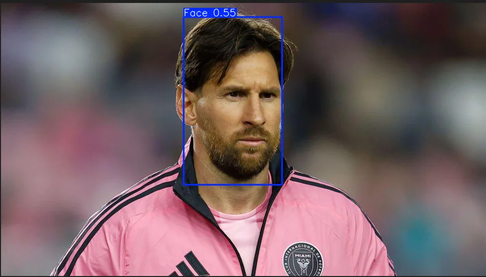
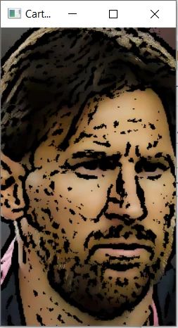

# Face Detection and Cartoonization

**Custom YOLOv8 face detector plus an OpenCV cartoon filter**

Detects faces with a YOLOv8 model I trained on a labelled face dataset, then turns each detected face into a cartoon-style image with classic image processing.

Visual Computing and Image Processing course · Individual project

Case study on my portfolio: https://amrgalal28.github.io/projects/face-cartoonizer.html

## Highlights

| Metric | Value |
|---|---|
| custom-trained face detector | **YOLOv8n** |
| OpenCV cartoon pipeline | **4-step** |

## Problem

Cartoonizing a whole photo also stylizes the background. Finding the face first lets the effect focus on it.

## Approach

- Trained YOLOv8n on a labelled face dataset from Roboflow Universe (20 epochs, 128×128 images).
- Ran the best checkpoint on new images and cropped each detected face from its bounding box.
- Cartoonized each crop: grayscale and median blur, an adaptive-threshold edge mask, bilateral colour smoothing, then a bitwise combination of the edges with the smoothed colours.

## Results

- Detection was reliable on frontal faces in general lighting, and the cartoon output kept the main facial features with bold outlines and flat colour.

## Figures

*YOLOv8 face detection*

*Cartoonized face crop*

## Tech stack

Python · Ultralytics YOLOv8 · OpenCV · PyTorch · NumPy

## Repository contents

| Path | Description |
|---|---|
| `notebooks/face_detection_cartoonizer.ipynb` | YOLOv8 training, face cropping and the cartoon filter |
| `docs/report.pdf` | Coursework report |
| `samples/input.jpg` | Sample input image |

## How to run

Open the notebook in Jupyter or Google Colab and run the cells in order.

Main libraries: ultralytics, opencv-python, torch, NumPy, Matplotlib.

## Data

A labelled face-detection dataset from Roboflow Universe (not included). Download one in YOLO format and point `data.yaml` at it.

## Author

Amr Rizk, AI & Machine Learning Engineer · [Portfolio](https://amrgalal28.github.io) · [LinkedIn](https://www.linkedin.com/in/amr-rizk-computer-science) · amrgalal20042@gmail.com
